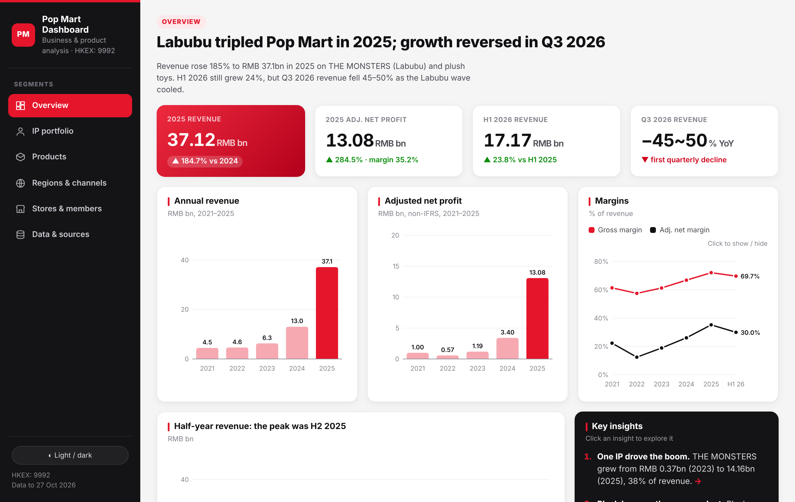
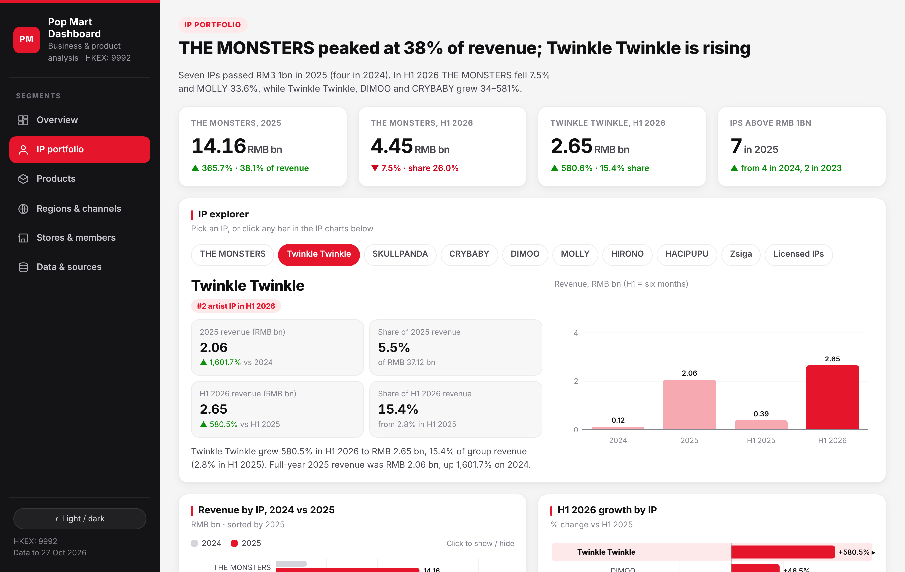
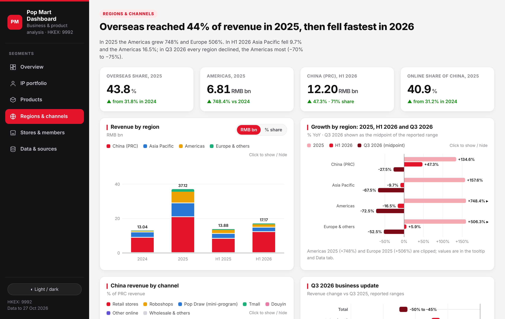

# Pop Mart Business & Product Dashboard

An interactive, single-page dashboard that analyses Pop Mart International Group (HKEX: 9992): revenue, IP portfolio, product categories, regions, sales channels, stores and members, from 2021 to the Q3 2026 business update. Every figure comes from the company's public filings.

**Live demo:** `https://<your-username>.github.io/popmart-dashboard/` *(replace with your GitHub Pages link)*



## Key findings

| Question | Answer |
|---|---|
| How big was the Labubu boom? | Revenue rose 185% to RMB 37.1bn in 2025. THE MONSTERS (Labubu) made RMB 14.2bn, 38% of revenue, up from 6% in 2023. |
| What changed in the product mix? | Plush overtook blind-box figures: 3% of revenue in 2023, 50% in 2025, 57% in H1 2026. |
| Where did growth come from? | Overseas reached 44% of revenue in 2025; the Americas grew 748%. |
| Is growth slowing? | Yes. H1 2026 grew 24%, then Q3 2026 revenue fell 45–50% year on year, with the Americas down 70–75%. |
| What is the next growth engine? | Twinkle Twinkle: RMB 2.65bn in H1 2026 (+581%), now the #2 artist IP. |

## Features

- **Six segments** in a left-hand navigation: Overview, IP portfolio, Products, Regions & channels, Stores & members, Data & sources.
- **IP explorer:** pick any IP (or click a bar) to see its revenue, growth, share of revenue and rank.
- **Click-to-toggle legends:** hide or show any series and the chart redraws.
- **RMB / % share switch** on the region and category charts.
- **Click-through insights:** each key insight links to the segment that proves it.
- Hover tooltips on every chart, light and dark mode, and a responsive layout for phones.
- **No dependencies:** one HTML file with hand-written SVG charts in vanilla JavaScript. No framework, no build step, works offline.





## Data

All figures are in RMB million unless stated. The CSV files in [`data/`](data/) are the exact values used by the dashboard.

| File | Contents |
|---|---|
| `financials_annual.csv` | Revenue, adjusted net profit, gross margin, 2021–2025 |
| `financials_half_year.csv` | H1 2025, H2 2025 (derived), H1 2026 |
| `revenue_by_ip.csv` | Revenue by IP, FY2024, FY2025, H1 2025, H1 2026 |
| `revenue_by_category_annual.csv` / `_h1.csv` | Plush, figures, MEGA, other products |
| `revenue_by_region.csv`, `region_growth.csv` | China, Asia Pacific, Americas, Europe & others |
| `q3_2026_business_update.csv` | Reported Q3 2026 growth ranges |
| `china_revenue_by_channel.csv` | Retail stores, roboshops, Pop Draw, Tmall, Douyin, other online, wholesale |
| `retail_stores_by_region.csv`, `operations.csv` | Store counts, mainland members, roboshops |
| `sources.csv` | Every source document with its link |

### Methodology notes

- "China (PRC)" includes Hong Kong, Macao and Taiwan, following Pop Mart's 2025–2026 reporting.
- H2 2025 = full-year 2025 minus H1 2025.
- Q3 2026 was published only as growth ranges, so it is shown as ranges, not amounts.
- Adjusted net profit is Pop Mart's non-IFRS measure.
- Revenue per store is an approximation using period-end store counts.

### Sources

- Pop Mart annual results announcements for 2022, 2023, 2024 and 2025, and the 2026 interim results announcement (HKEX).
- Q3 2025 and Q3 2026 business updates, as reported by Jiemian, Yicai and 36Kr.

Full links are in [`data/sources.csv`](data/sources.csv).

## Run it locally

Download or clone the repository and open `index.html` in any modern browser. No installation is needed.

## Repository structure

```
popmart-dashboard/
├── index.html              # the dashboard (single file)
├── data/                   # CSV data used in the dashboard
├── docs/screenshots/       # images for this README
├── LICENSE
└── README.md
```

## Disclaimer

This is an independent analysis of publicly available information for portfolio purposes. It is not affiliated with, endorsed by or sponsored by Pop Mart International Group. "Pop Mart", "THE MONSTERS", "Labubu" and other IP names are trademarks of their respective owners. Nothing here is investment advice.

## Author

**Xiaoyu (Jessy) Mao** · Data Analyst
